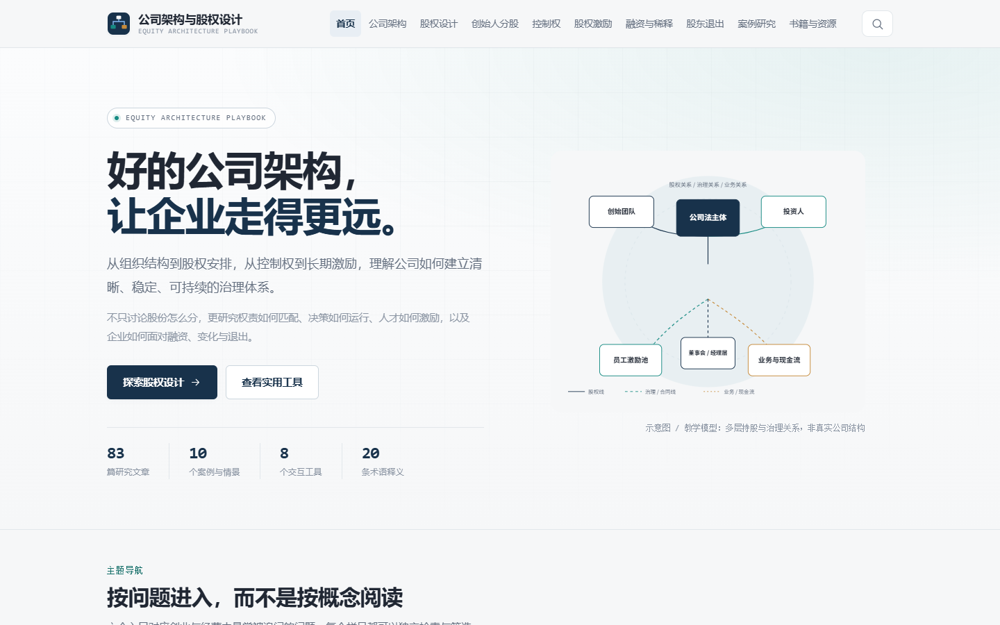
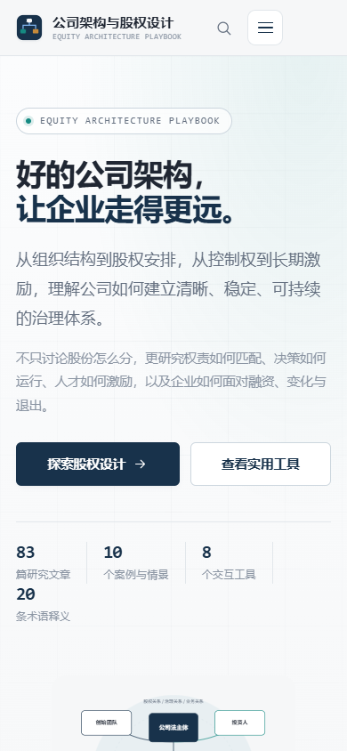
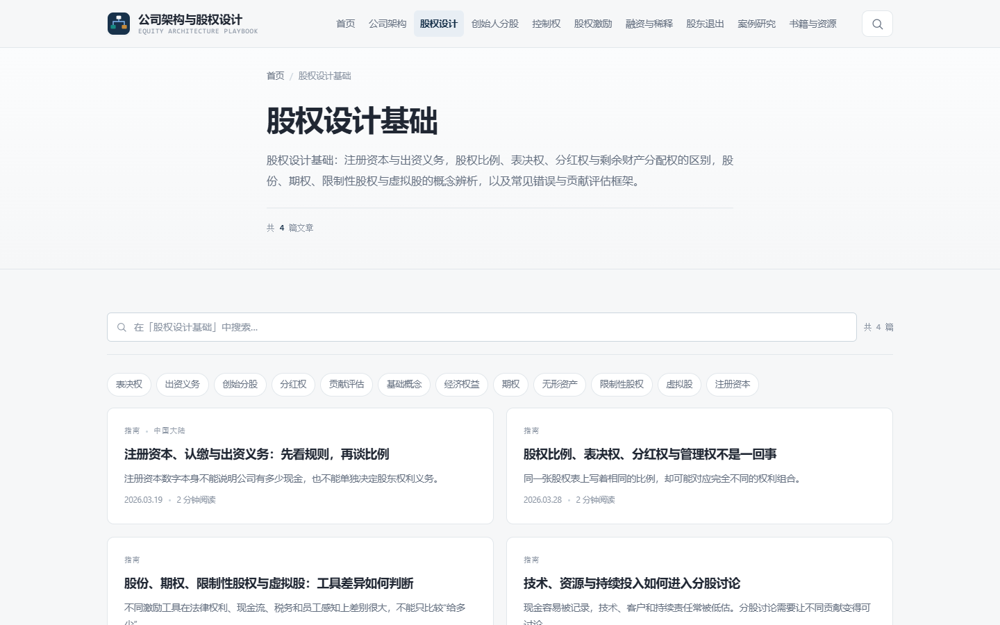
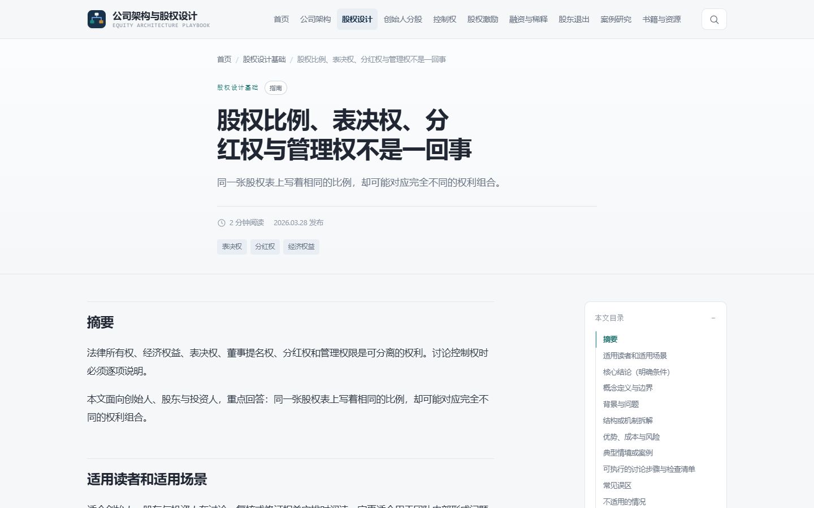
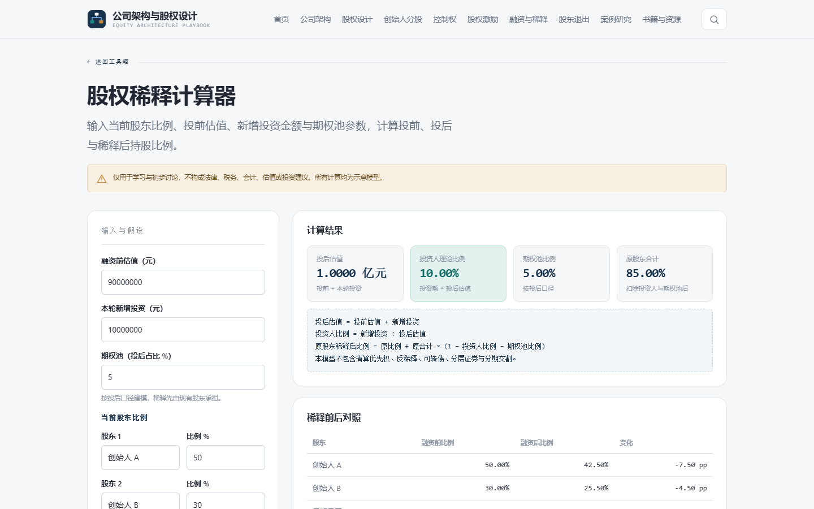
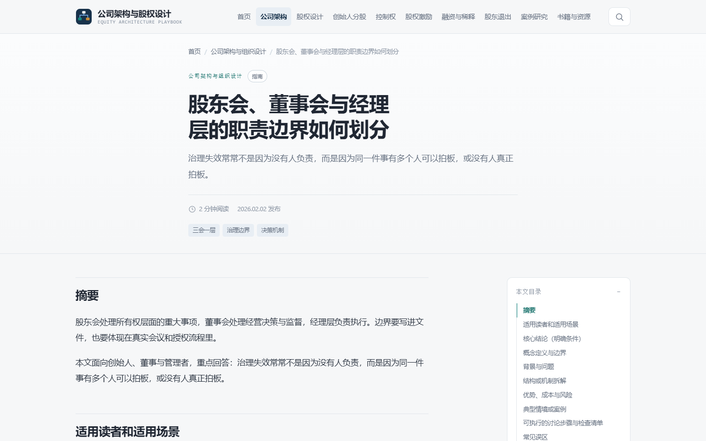
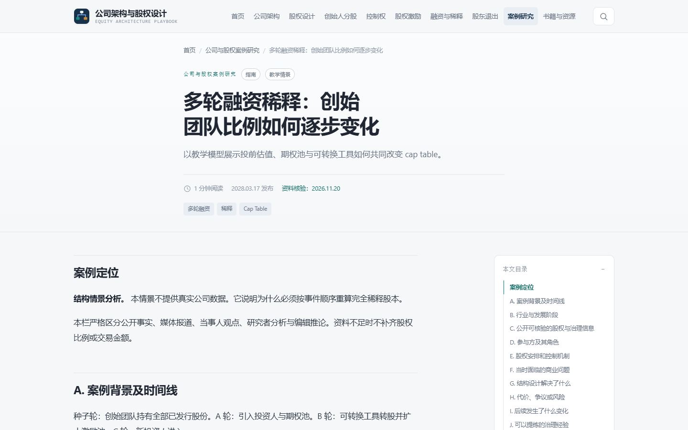

# 公司架构与股权设计 · Equity Architecture Playbook

一个系统研究公司组织架构、股权架构、公司治理、创始人股权分配、控制权设计、员工股权激励、融资稀释、股东退出与企业长期治理的中文知识库。

## 1. 项目名称与定位

- 中文站点名：公司架构与股权设计
- 英文站点名：Equity Architecture Playbook
- GitHub 仓库名：`equity-architecture-playbook`
- 定位：现代商业研究杂志 + 专业公司治理知识库 + 清晰的数据分析工具
- 核心主张：好的股权设计，不是简单地把股份分完，而是让贡献、责任、控制、收益、风险和退出机制形成长期可持续的安排。

本站不是法律意见书，不提供针对具体企业的法律、税务、会计、估值或投资结论。所有涉及法律、税务、监管、上市规则和跨境安排的内容，都明确标注法域、适用主体、资料日期和不确定性。

## 2. 品牌理念与适用读者

站内所有内容坚持以下原则：

- 区分股权比例、表决权、董事席位、管理权限、分红权、剩余财产分配权、协议控制、实际控制认定、经济权益与法律所有权。
- 不把 51%、67% 等比例说成所有公司、所有事项上的绝对控制权。
- 不把中国大陆《公司法》规则直接套用到香港、新加坡或美国公司，也不把 Delaware 规则套用到其他州或国家。
- 区分公开事实、媒体报道、当事人观点、研究者分析和编辑推论。
- 资料不足时标注为「教学案例」或「结构情景分析」，不冒充真实公司案例。

适用读者：创业者、企业创始人、股东、管理者、投资人、企业服务从业者，以及公司治理与股权研究者。

## 3. 当前首版内容规模

以上统计由构建脚本按实际内容自动生成，写入首页，不使用伪造数字。

| 类型 | 数量 |
| --- | ---: |
| 研究文章 | 83 篇 |
| 案例与情景分析 | 10 篇 |
| 交互工具 | 8 个 |
| 术语词条 | 20 条 |
| 书籍介绍 | 15 本 |
| 法规与专业资源 | 20 条 |
| 金句与编辑观点 | 17 条 |
| 独立静态页面 | 124 个 |

内容覆盖公司架构、股权设计、创始人分股、控制权与治理、股东协议、员工激励、融资与稀释、持股平台、股东退出、公司治理、财税基础、案例研究、实操场景、书单、术语、法规资源与研究方法。

其中法律、税务与案例类文章已标注法域或「教学情景」类型及资料访问日期。资料入口状态在 `/resources/` 中逐条列出；未实际完成内容核验的来源明确标记为「入口待核验」，不冒充现行规则结论。

## 4. 功能介绍

### 4.1 独立页面

- 独立设计的首页与原创本地 SVG Hero。
- 17 个栏目页，均具备关键词搜索、类型/法域筛选与标签筛选。
- 93 篇文章详情页，含目录、阅读进度、收藏、复制链接、打印、来源、免责声明、相关阅读与上一篇/下一篇。
- 工具箱、书单、术语词典、法规资源、金句、搜索页、收藏页、关于页与 404 页。

### 4.2 交互工具

所有工具在浏览器本地运行，不向服务器提交任何输入。

1. 创始人股权分配讨论器：可编辑贡献矩阵与情景比较，不输出「公平比例」或权威评分。
2. 股权稀释计算器：按简化增资模型计算投前、投后、期权池与稀释结果。
3. 投前投后估值计算器：计算投后估值、投资人理论比例与敏感性情景。
4. 归属时间线演示器：演示 Cliff、归属频率与累计归属进度。
5. 股权结构图生成器：本地生成 SVG，可导出与打印。
6. 控制权与治理矩阵：可编辑、可导出 CSV。
7. 公司架构检查表：按勾选情况提示应研究的问题，不生成法律架构结论。
8. 股权设计体检清单：显示未明确缺口，不是合规审查报告。

### 4.3 站内功能

- 全站搜索弹层与独立搜索页，支持按类型、法域筛选。
- 文章收藏与最近阅读，使用 `localStorage` 保存在本地浏览器。
- 金句复制、收藏与本地 SVG 分享卡片。
- 术语词典搜索与拼音首字母筛选。
- 面包屑、响应式导航、移动端菜单、焦点状态与 `prefers-reduced-motion` 支持。

## 5. 在线演示地址

本项目尚未部署到固定公开地址。为避免伪造网址，README 不填写虚构的在线演示链接。

部署完成后，GitHub Pages 默认地址由仓库所有者与仓库名决定，格式通常为：

`https://<仓库所有者>.github.io/equity-architecture-playbook/`

如果使用自定义域名，请在仓库 Settings → Pages 中设置自定义域名，并按说明配置 DNS。

## 6. 技术栈与架构

本项目采用**零运行时依赖的自研静态站点生成器**，没有引入 Next.js、Nuxt、大型 UI 框架或重量级图表库。

- 构建：Node.js 18+，原生 ESM
- 前端：HTML5、CSS3、原生 JavaScript（ES Modules）
- 内容：`content/**/*.md` + `data/*.json`
- Markdown：自研轻量渲染器，无第三方解析库
- 图表：数据驱动生成的原创 SVG，无图表库
- 搜索：构建期生成 `search-index.json`，前端本地检索
- 托管：GitHub Pages，GitHub Actions 自动部署

选择该架构的原因：所有关键内容直接进入静态 HTML，适合搜索引擎抓取；构建简单、依赖少、便于本地运行和长期维护。

## 7. 项目目录树

```text
equity-architecture-playbook/
├── .github/workflows/deploy.yml
├── content/
│   ├── company-structure/
│   ├── equity-design/
│   ├── founder-equity/
│   ├── control-rights/
│   ├── shareholder-agreement/
│   ├── equity-incentives/
│   ├── fundraising/
│   ├── holding-structure/
│   ├── shareholder-exit/
│   ├── corporate-governance/
│   ├── finance-tax/
│   ├── case-studies/
│   └── scenarios/
├── data/
│   ├── books.json
│   ├── categories.json
│   ├── glossary.json
│   ├── quotes.json
│   ├── sources.json
│   └── tools.json
├── docs/screenshots/
├── public/assets/
│   ├── ASSET-SOURCES.md
│   ├── diagrams/
│   ├── illustrations/
│   ├── images/
│   ├── icons/
│   └── quotes/
├── scripts/
│   ├── build.js
│   ├── content-seed/
│   ├── dev.js
│   ├── generate-assets.js
│   ├── generate-content.js
│   ├── lib/
│   ├── pages/
│   ├── preview.js
│   ├── screenshots.js
│   └── validate-content.js
├── src/
│   ├── scripts/
│   │   └── tools/
│   └── styles/
├── site.config.js
├── package.json
└── README.md
```

## 8. 环境要求

- Node.js 18 或更高版本
- npm 10 或更高版本（其他近期版本通常也可）
- 生成截图时需要本机已有 `playwright-cli`；项目不会自动安装重量级浏览器依赖

## 9. 安装与本地运行

```bash
npm install
npm run dev
```

默认访问：`http://localhost:4173/`

`npm run dev` 会先构建站点，监听 `content/`、`data/`、`scripts/`、`src/` 与 `public/` 的文件变化并自动重建。若 4173 端口被占用，可通过环境变量指定端口，例如在 Windows PowerShell 中：

```powershell
$env:PORT = '49123'
npm run dev
```

## 10. 构建与预览

```bash
npm run validate
npm run build
npm run preview
```

构建产物位于 `dist/`。`npm run build` 会：

- 校验内容必填字段、slug 重复、来源引用、法域标注与字数；
- 生成首页、栏目页、文章页、工具页与功能页；
- 复制 CSS、JavaScript、SVG 与静态资源；
- 检查内部链接与本地资源；
- 生成 `search-index.json`、`sitemap.xml` 和 `robots.txt`。

如需模拟 GitHub Pages 子路径构建：

```bash
BASE_PATH=/equity-architecture-playbook/ SITE_URL=https://example.github.io/equity-architecture-playbook npm run build
```

在 Windows PowerShell 中：

```powershell
$env:BASE_PATH = '/equity-architecture-playbook/'
$env:SITE_URL = 'https://example.github.io/equity-architecture-playbook'
npm run build
```

上面的域名仅为本地模拟占位，不会写入仓库配置。

## 11. GitHub Pages 部署步骤

1. 将代码推送到 GitHub 仓库的 `main` 分支。
2. 打开仓库 Settings → Pages。
3. Build and deployment 选择 **GitHub Actions**。
4. 确认 `.github/workflows/deploy.yml` 存在且已启用。
5. 推送 main 分支后，Actions 会自动安装依赖、校验内容、构建并部署。
6. 构建时 `BASE_PATH` 会按仓库名自动设置为 `/equity-architecture-playbook/`。
7. `SITE_URL` 默认由 GitHub 仓库所有者与仓库名推导；如需自定义域名，可在仓库 Variables 中设置 `SITE_URL` 为完整域名（不含末尾斜杠）。

### 自定义域名

本项目默认不写入虚构域名，也不附带 `CNAME` 文件。若使用自定义域名：

1. 在域名 DNS 服务商按 GitHub Pages 文档配置 A / AAAA 或 CNAME 记录。
2. 在仓库 Settings → Pages → Custom domain 填写你的域名。
3. 若要让域名在仓库内容中显式维护，可在 `public/CNAME` 中写入真实域名；该文件会随构建复制到 `dist/CNAME`。
4. 同步将仓库 Variables 中的 `SITE_URL` 设置为该域名，以保证 canonical 与 sitemap 正确。

## 12. 如何新增文章

在对应栏目目录新建 Markdown 文件，例如 `content/equity-design/new-article.md`：

```markdown
---
title: "文章标题"
description: "一句话摘要"
slug: "new-article"
category: "equity-design"
tags: ["股权设计", "表决权"]
author: "编辑团队"
publishedAt: "2026-11-20"
updatedAt: "2026-11-20"
contentType: "指南"
featured: false
order: 99
sources: ["cn-flk"]
jurisdiction: ["中国大陆"]
verifiedAt: "2026-11-20"
disclaimerType: "法域与核验"
---

## 摘要

## 适用读者和适用场景

## 核心结论（明确条件）

## 概念定义与边界

## 背景与问题

## 结构或机制拆解

## 优势、成本与风险

## 典型情境或案例

## 可执行的讨论步骤与检查清单

## 常见误区

## 不适用的情况

## 总结金句

## 参考资料

## 内容适用法域与资料核验日期
```

注意：

- `category` 必须与所在目录一致，且 slug 全站唯一。
- `sources` 中的 ID 必须存在于 `data/sources.json`。
- 涉及法律、税务、监管、案例的内容必须填写 `jurisdiction` 与 `verifiedAt`。
- `npm run validate` 会检查大部分常见错误；构建时会再次校验。

`npm run content` 会从 `scripts/content-seed/` 重新生成首版文章。若你已直接编辑 `content/` 中的文章，请先备份修改，避免被覆盖。

## 13. 如何新增案例、书籍、术语和资源

- 案例：在 `content/case-studies/` 新建 Markdown，使用 A–L 案例模板；资料不足时 `caseType` 设为「教学案例」或「结构情景分析」。
- 书籍：编辑 `data/books.json`，填写书名、作者、版本、出版方、概览、局限与适用读者；版本信息不确定时明确标注待核验。
- 术语：编辑 `data/glossary.json`，包含定义、常见误用与相关文章链接。
- 法规资源：编辑 `data/sources.json`，每条记录发布机构、法域、来源类型、链接、发布日期、访问日期、状态与说明。无法确认时写「入口待核验」，不要编造条文编号或监管口径。

## 14. 如何维护图片与 SVG

- 原创 SVG 由 `npm run assets` 生成，源文件逻辑位于 `scripts/generate-assets.js`。
- 所有实际使用的视觉资产都保存在 `public/assets/` 下，并登记于 `public/assets/ASSET-SOURCES.md`。
- 不引用远程图片 URL；不使用未经授权的商业摄影、书籍封面或品牌素材。
- 所有图片必须有 `alt`；纯装饰图使用空 `alt`。
- 结构图必须标注「示意图 / 教学模型」，图例需区分股权线、治理线、合同线和业务流。

## 15. 如何更新法规来源和核验日期

1. 打开官方一手来源，确认页面可访问且内容属于该机构。
2. 记录访问日期、页面标题、发布机构与当前状态。
3. 更新 `data/sources.json` 中对应条目的 `accessedAt`、`verifiedAt`、`status`。
4. 若只访问了入口首页而没有核对具体条文，不要填写 `verifiedAt`，并将状态写为「入口已访问；具体条文需读者复核」。
5. 更新引用该来源的文章中的 `verifiedAt`，并在正文中说明核验范围。

## 16. 内容审核与引用规范

- 优先引用官方一手来源；媒体、学术研究和商业出版物作为辅助。
- 区分强制性规定、章程自治、合同安排、市场惯例与专业建议。
- 引用他人原话必须有可靠出处；无法核验的改为「编辑观点」或「原创总结」。
- 案例不使用未经核验的股权比例、金额或交易结果。
- 不提供逃税、隐匿实际控制人、规避外汇/监管、虚假出资、抽逃出资、欺诈融资或损害债权人利益的操作指导。

## 17. 免责声明

本站内容仅供研究与教育目的，不构成法律意见、税务建议、估值报告、投资决策依据或针对任何具体商业交易的推荐方案。本站不形成编辑者与读者之间的律师—客户关系、会计师—客户关系或任何形式的专业顾问关系。

读者在依据本站内容作出商业、法律或财务决策之前，必须咨询所在法域的合格专业人士。

## 18. 版权与贡献说明

- 代码：MIT License
- 原创 SVG 与编辑内容：CC BY-NC-SA 4.0（如需商用授权，请联系维护者）
- 贡献方式：提交 Issue 指出事实错误、断链或内容缺口；提交 PR 时请附来源链接与核验日期。
- 不得提交未经授权的图片、书籍封面、整段书籍内容或无法核验的名人引述。

## 19. 网页截图

以下截图均由 `playwright-cli` 在真实浏览器中打开本地构建站点后生成，时间为 2026-11-20。截图文件真实存在于 `docs/screenshots/`。















如需重新生成截图：

```bash
npm run build
npm run screenshots
```

若本机没有 `playwright-cli`，脚本会明确报错退出，不会伪造截图。
